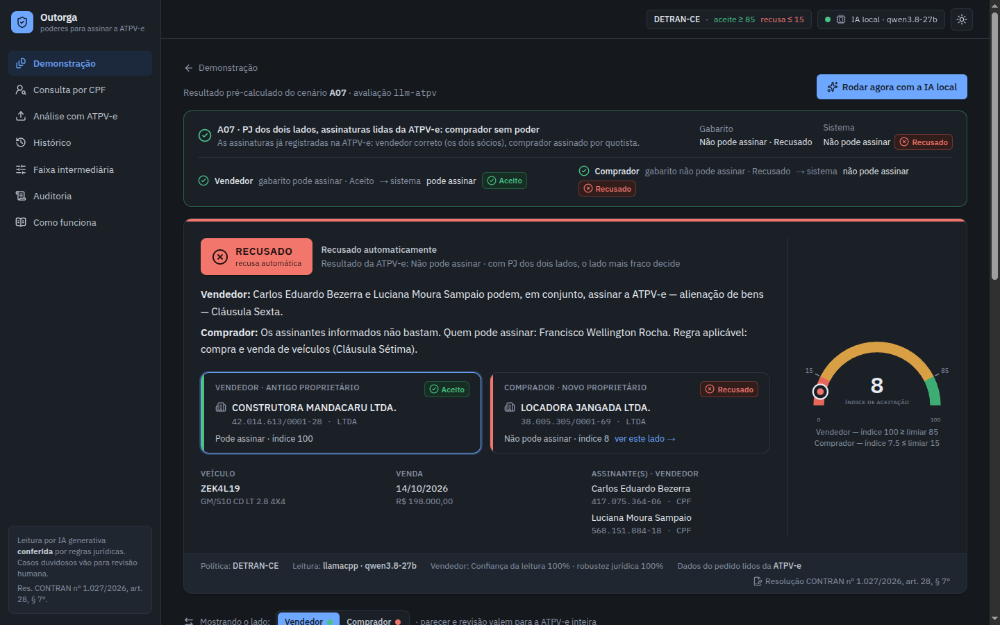
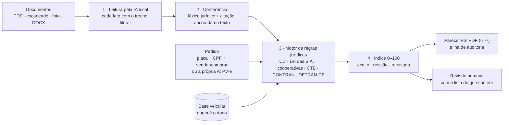
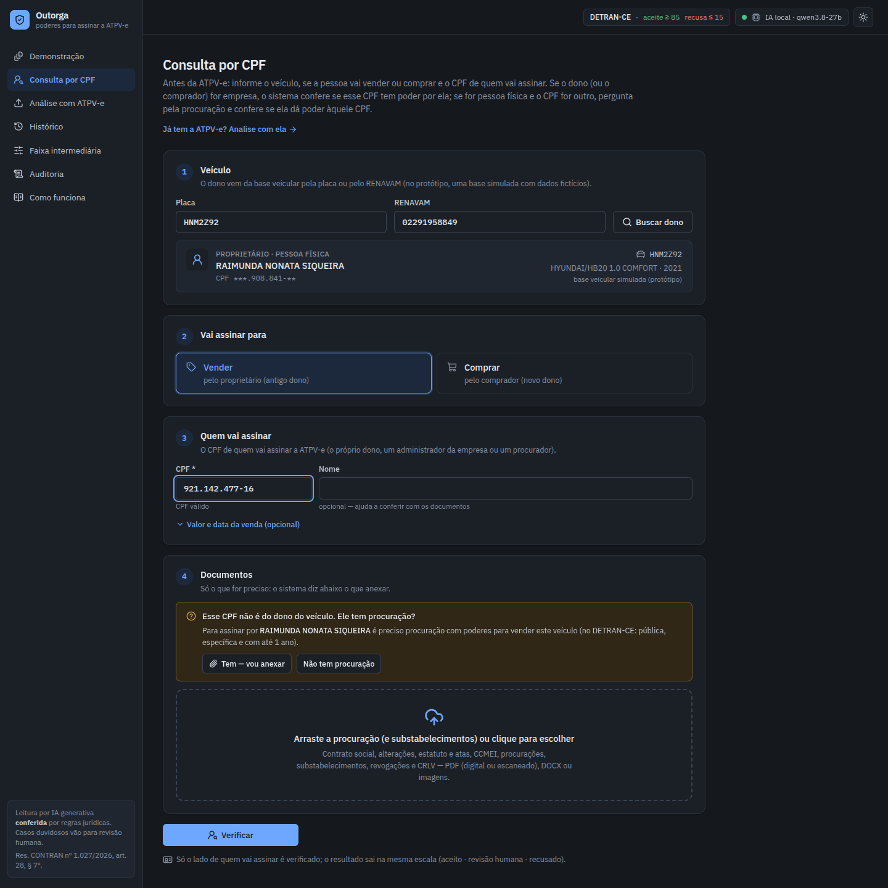
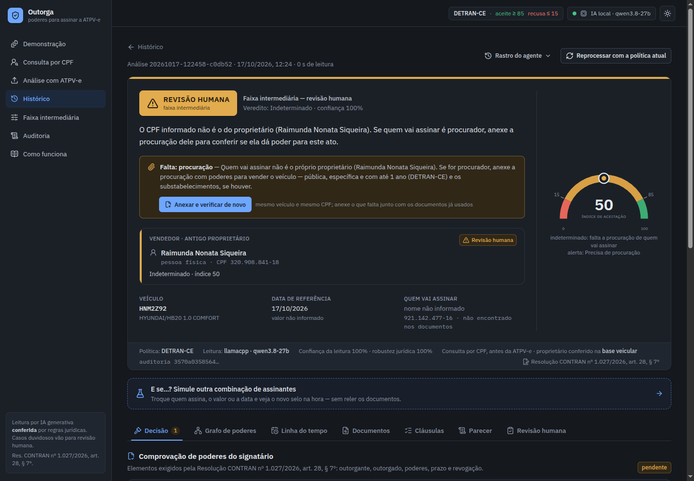
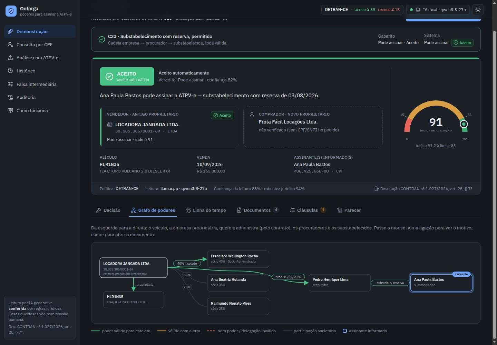
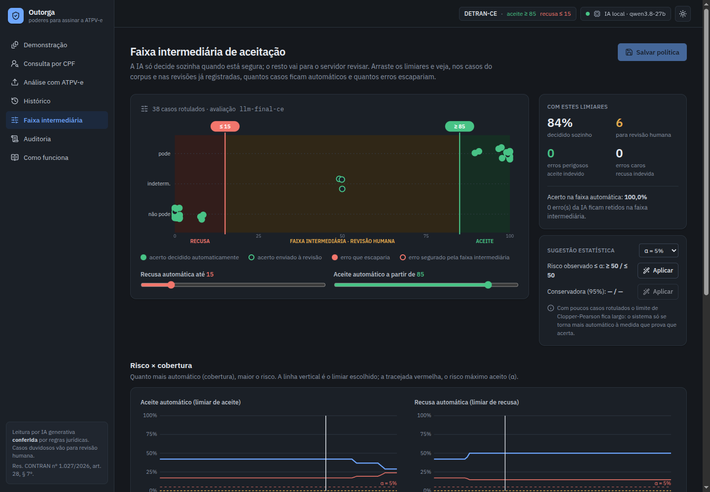
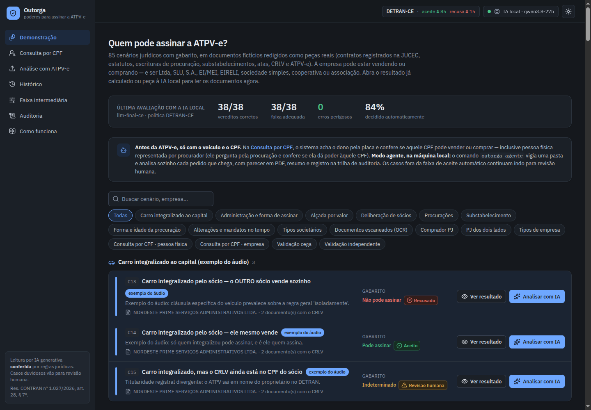
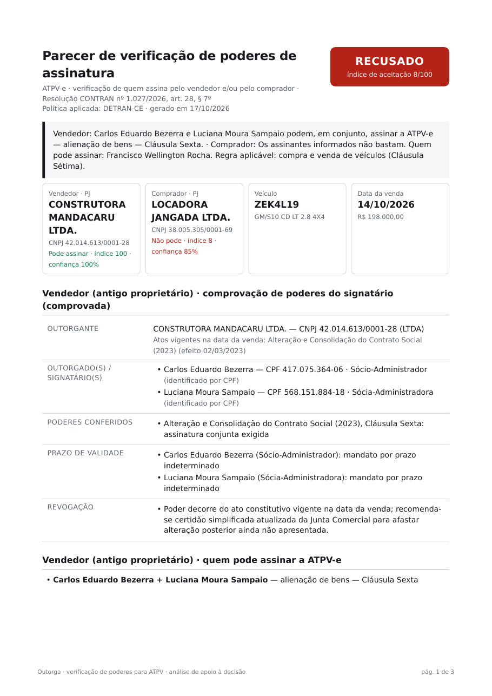
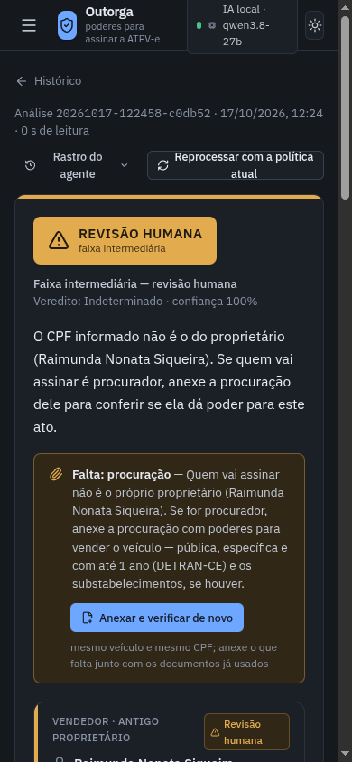

<div align="center">

# Outorga

### Quem pode assinar a ATPV-e? Verificação de poderes com IA local e regras jurídicas


</div>

<p align="center">
  
</p>

O **Outorga** verifica, **antes da assinatura da ATPV-e**, se quem vai assinar tem poder para **vender ou comprar** aquele
veículo. Vale para empresa de qualquer tipo e para pessoa física representada por procurador.

O sistema lê os documentos (ATPV-e, contrato social e alterações, estatuto, atas, procurações, substabelecimentos,
revogações, CRLV) com uma **IA que roda na própria máquina**, e nada sai do computador. Uma camada de **regras jurídicas**
confere a leitura e decide. A resposta sai numa escala de 0 a 100, com três faixas: 🟢 **aceito**, 🟡 **revisão humana**
e 🔴 **recusado**.

> Protótipo desenvolvido no Núcleo de Informática do DETRAN-CE. **Todos os nomes, CPFs, CNPJs, placas e documentos deste
> repositório são fictícios.** Análise de apoio à decisão: não substitui a conferência do servidor responsável.

---

## Por que isso importa agora

A **Resolução CONTRAN nº 1.027/2026** (DOU de 18/08/2026), que revogou a 809/2020, diz no **art. 28, § 7º**:

> "Quando o antigo ou o novo proprietário for pessoa jurídica, a assinatura será admitida mediante **comprovação
> eletrônica dos poderes do signatário**, por consulta a bases oficiais ou por instrumento de outorga verificável, com
> identificação do outorgante, do outorgado, dos poderes conferidos, do prazo de validade e de eventual revogação […]"

O prazo de adequação termina por volta de **16/11/2026**. O CNJ (Provimento nº 252/2026) registra que a plataforma federal
de venda digital não aceita pessoa jurídica "em razão da inviabilidade de verificação automatizada e segura de poderes
societários". O Outorga faz essa verificação, e o parecer sai exatamente nos cinco elementos do § 7º.

## O que ele responde

| Situação | Exemplo de resposta |
|---|---|
| **Antes da ATPV-e**, só com placa + CPF + vender/comprar | "Maria do Socorro Viana pode assinar como compradora — Art. 20 do estatuto" |
| Empresa com regra de assinatura | "Exige os dois sócios em conjunto: Carlos **e** Luciana" |
| Pessoa física e o CPF não é o do dono | "O CPF não é o do proprietário. Tem procuração? Anexe para conferir" |
| Procuração com problema | "Procuração vencida em 01/04/2026" · "dada pela esposa, não pelo dono registral" · "só poderes gerais: vender exige poder especial (CC, art. 661)" |
| Cooperativa ou associação | "Diretor-Presidente **em conjunto com** o Diretor Financeiro (ata da AGO de 2025)" |
| PJ dos dois lados | "Vendedor pode; comprador não: quem assinou é sócia quotista sem poder" |

## Como funciona



1. A **IA generativa lê** e cita o trecho exato de cada fato, em JSON validado.
2. A **conferência** corrige leituras erradas conhecidas e confere se cada citação existe no documento. Medido: a IA
   sozinha leu "indistintamente" como assinatura conjunta, que é o contrário.
3. O **motor de regras decide**: quem administra na data da venda, assinatura conjunta, alçada de valor, cláusula do
   veículo específico, aprovação de sócios, cargos de estatuto, procuração (poderes, prazo, revogação, veículo, forma),
   substabelecimento, titularidade. A IA não decide sozinha.
4. A **faixa intermediária** manda para revisão humana tudo o que tiver dúvida ou documento faltando, com a lista do que
   conferir. Os limites são calibráveis.

## Telas

<table>
  <tr>
    <td width="50%"><br><b>Consulta por CPF, antes da ATPV-e.</b> Placa, papel e CPF; o dono vem da base veicular e o sistema diz o que anexar.</td>
    <td width="50%"><br><b>"Tem procuração?"</b> CPF diferente do dono e sem procuração: o caso fica pendente, não é recusado.</td>
  </tr>
  <tr>
    <td><br><b>Grafo de poderes.</b> Empresa → administrador → procurador → substabelecido, com o motivo de cada ligação.</td>
    <td><br><b>Faixa intermediária calibrável.</b> Arraste os limites e veja quantos casos ficam automáticos e quantos erros escapariam.</td>
  </tr>
  <tr>
    <td><br><b>Demonstração.</b> 85 cenários fictícios com o resultado real da IA local e o gabarito.</td>
    <td><br><b>Parecer em PDF</b> no formato do § 7º, por lado (vendedor e comprador), com fontes e hashes.</td>
  </tr>
</table>

<p align="center"><br><sub>A interface também funciona no celular.</sub></p>

## Resultados dos testes

85 cenários fictícios com gabarito. Na primeira rodada de cada lote, a IA local leu todos os documentos do zero.

| Lote | Veredito | Aceites indevidos | Observação |
|---|---|---|---|
| Motor com leitura perfeita (gabarito), todos os lotes | **100%** | 0 | valida as regras jurídicas |
| 38 cenários principais (exemplos do áudio, Código Civil) | **37/38** | 0 | |
| 8 cenários novos, redação inédita (cego) | **7/8** | 0 | |
| 10 casos de um autor independente, sem acesso ao código (cego) | **7/10** | **2** | os 2 erros viraram regras gerais e testes |
| 14 casos com ATPV-e: empresa dos dois lados, cooperativa, associação, MEI, EIRELI, sociedade simples (cego) | **14/14** | 0 | achou um risco latente, corrigido |
| 15 consultas por CPF: pessoa física e procuração (cego) | **15/15** | 0 | |

O teste independente foi o mais duro, e é a razão de a faixa intermediária existir. A recomendação é um **piloto com
processos reais anonimizados** antes de deixar o sistema decidir sozinho. Detalhes em
[`docs/RESULTADOS.md`](docs/RESULTADOS.md). Máquina, IA, metodologia e horários de cada rodada em
[`docs/COMO_FOI_TESTADO.md`](docs/COMO_FOI_TESTADO.md).

## Como rodar

### Requisitos

- Linux (testado no Kubuntu 26.04), Python 3.12+ com [**uv**](https://docs.astral.sh/uv/), Node.js 20+ com **pnpm**
- Tesseract com português, para documentos escaneados: `sudo apt install tesseract-ocr tesseract-ocr-por`
- Bibliotecas do WeasyPrint, para o PDF: `sudo apt install libpango-1.0-0 libpangoft2-1.0-0`
- **Uma IA**, à escolha, configurada no arquivo `.env` (modelo em [`.env.example`](.env.example); detalhes em
  [`docs/IA.md`](docs/IA.md)):
  - **local, com GPU**: llama.cpp, Ollama, LM Studio ou vLLM. Nos testes: llama.cpp + Qwen3.8-27B numa RTX 3060 de 12 GB;
  - **local, sem GPU**: funciona, mas num desktop comum fica lento demais (medido: [`docs/COMO_FOI_TESTADO.md`](docs/COMO_FOI_TESTADO.md#7-medição-só-em-cpu-sem-gpu));
  - **por chave de API**: Anthropic (Claude), OpenAI, Google Gemini, Groq, OpenRouter, DeepSeek, Mistral, Together, xAI
    ou qualquer API compatível com a da OpenAI;
  - **sem IA nenhuma**: a demonstração, a consulta por CPF sem documentos, a simulação e o parecer funcionam do mesmo
    jeito. A IA só é necessária para ler documentos novos.

### Instalação

```bash
git clone https://github.com/DanielFreitasDev/outorga.git && cd outorga
uv sync                                    # dependências Python
(cd web && pnpm install && pnpm build)     # interface
uv run pytest -q                           # 228 testes, sem IA
./scripts/iniciar.sh                       # API + interface em http://127.0.0.1:8765
```

### Formas de usar

| Forma | Como |
|---|---|
| **Tela web** | `./scripts/iniciar.sh` → http://127.0.0.1:8765: consulta por CPF, análise com ATPV-e, demonstração, simulação "e se…?", revisão humana, faixa intermediária, auditoria |
| **Consulta por CPF** (linha de comando) | `uv run outorga consultar --placa HNM2Z92 --cpf <CPF> --papel vender [procuracao.pdf …]` |
| **Modo agente** (pasta vigiada, local) | `uv run outorga agente --entrada ~/outorga/entrada --saida ~/outorga/saida`. Cada subpasta com a ATPV-e e os documentos vira `parecer.pdf`, `resumo.txt` e `resultado.json`. Há um serviço systemd pronto em `scripts/outorga-agente.service` |
| **API** (integração) | `POST /api/analises`, `GET /api/veiculo`, `POST /api/atpv/ler`, `POST /api/analises/{id}/simular`; documentação interativa em `/docs`. Ver [`docs/INTEGRACAO.md`](docs/INTEGRACAO.md) |
| **Análise de uma pasta** | `uv run outorga analisar corpus/casos/A07 --pdf parecer.pdf` |

## Documentação

| Documento | Conteúdo |
|---|---|
| [`docs/PARA_O_CHEFE.md`](docs/PARA_O_CHEFE.md) | resumo executivo: o pedido, o que existe, resultados, o que falta confirmar |
| [`docs/COMO_FOI_TESTADO.md`](docs/COMO_FOI_TESTADO.md) | máquina, IA local, stack, metodologia, linha do tempo dos testes, uso sem GPU |
| [`docs/IA.md`](docs/IA.md) | como ligar a IA: local (com ou sem GPU) ou por chave de API (Anthropic, OpenAI, Gemini…) |
| [`docs/MODELOS.md`](docs/MODELOS.md) | comparação de modelos de IA local testados nesta máquina |
| [`docs/RESULTADOS.md`](docs/RESULTADOS.md) | todas as rodadas de avaliação, caso a caso, com as lições |
| [`docs/REGRAS.md`](docs/REGRAS.md) | as regras jurídicas codificadas, com fundamento e caso de teste |
| [`docs/ARQUITETURA.md`](docs/ARQUITETURA.md) | módulos, índice de aceitação, privacidade, desempenho |
| [`docs/INTEGRACAO.md`](docs/INTEGRACAO.md) | API, consulta por CPF, modo agente, requisitos de produção |
| [`docs/PESQUISA_JURIDICA.md`](docs/PESQUISA_JURIDICA.md) | pesquisa normativa: Res. CONTRAN 1.027/2026, CNJ, DETRAN-CE, Código Civil |
| [`docs/demo/outorga.html`](docs/demo/outorga.html) | página de demonstração autocontida (baixe e abra no navegador) |

## Estrutura

```
src/outorga/   leitura (ingest, extract, prompts, schemas), conferência (lexicon, grounding),
               motor (engine), pipeline, parecer, API, modo agente, base veicular
web/           interface React + TypeScript + Vite + Tailwind
corpus/        85 cenários fictícios: fatos e gabarito (spec.py), documentos (docs/*.md), casos montados
               (casos/<ID>/), gabarito de leitura (gold.py), base veicular simulada
tests/         228 testes (motor, cenários no modo oráculo, consulta por CPF, agente, API, provedores de IA)
avaliacoes/    resultados de todas as rodadas de avaliação (evidência dos números)
.cache/leituras/  leituras da IA local para o corpus fictício (reproduz a avaliação sem GPU)
docs/          documentação, pesquisa jurídica, imagens e página de demonstração
scripts/       iniciar.sh, agente.sh, serviço systemd, relatórios e exportação da demonstração
```

## Limitações e próximos passos

- **Corpus sintético.** Bom para regras e semântica; documentos reais trazem carimbos, rasuras e variações. Próximo
  passo: piloto com 20–30 processos reais anonimizados e recalibração da faixa.
- **Base veicular simulada.** No DETRAN, o dono viria da base RENAVAM pela placa ou pelo RENAVAM.
- **Leitor da ATPV-e** calibrado num layout simulado; precisa de amostras do PDF oficial. A IA cobre o que o leitor
  não reconhecer.
- **Não confere assinatura digital** nem consulta bases oficiais (Receita, Junta, CENSEC). São pontos de extensão
  previstos no § 7º.
- **Produção:** autenticação, servidor de inferência dedicado e política de retenção de documentos (LGPD).
