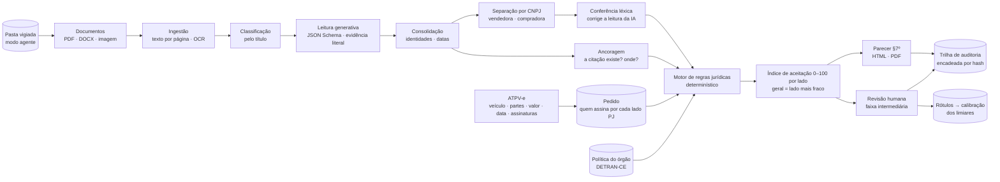

# Arquitetura



## Por que híbrido (neuro-simbólico)

A IA generativa é ótima para **ler** linguagem jurídica variada e péssima para **garantir** que a leitura está
certa. Medido nesta máquina, o Qwen 27B local, sem orientação jurídica, classificou "indistintamente" como
assinatura **conjunta** (é o contrário), mesmo raciocinando mais. Por isso:

1. a IA **lê e cita** — cada fato vem com o trecho literal (JSON Schema com a evidência antes da classificação);
2. a **conferência léxica** confere a classificação pelas próprias expressões citadas e corrige quando há
   divergência confiável ("indistintamente" → isolado; "vedada a prática isolada" → conjunto; restrição só a
   imóveis não alcança veículo);
3. a **ancoragem** procura cada citação no texto original (tolerante a OCR): citação inexistente = possível
   alucinação = revisão humana;
4. o **motor de regras** decide, com fundamento legal — e com a leitura perfeita do gabarito acerta 38/38;
5. o **índice** traduz tudo isso numa escala única com a faixa intermediária.

## Os dois lados da ATPV-e

A Res. CONTRAN 1.027/2026 (art. 28, §7º) fala do antigo **ou** do novo proprietário PJ. O pipeline
(`pipeline.analisar_leituras`) monta um `PedidoATPV` (vendedor e comprador, cada um PJ ou PF, com seus assinantes),
completa o que faltar com a leitura da **ATPV-e** e, para cada lado PJ, consolida **só os documentos daquela empresa**
(separados pelo CNPJ dono do documento, pelos CNPJs citados e pela razão social) e roda o motor com o ato certo:
**alienar** para o vendedor, **adquirir** para o comprador. Cada regra lida recebe os atos a que se aplica
(`lexicon.atos_da_regra`): cláusula de venda não restringe compra e vice-versa; regra geral vale para os dois.
Na procuração, poder de vender não é poder de comprar. O resultado traz `lados.vendedor`, `lados.comprador` e
`geral` (o lado mais fraco decide a faixa).

## Consulta por CPF e pessoa física

Na consulta antes da ATPV-e (`pipeline.pedido_cpf_de_json`), o proprietário vem de `base_veicular.consultar()` (no
protótipo, um JSON simulado; no DETRAN, a base RENAVAM) e só o lado do CPF é analisado (`PedidoATPV.alvo`). Um lado
**pessoa física** vira um "titular único" (`Consolidador.consolidar_pf`): o titular é o único que assina por si, e o motor
reaproveita toda a verificação de procuração e substabelecimento, com uma regra própria para quem outorgou (tem de ser o
titular). Sem procuração que cite o CPF, o resultado é uma pendência (`pendencias[].tipo = "procuracao"`), não uma recusa.

## Modo agente

`outorga agente` (`agente.py`) vigia uma pasta: cada subpasta ou `.zip` é um pedido (ATPV-e + documentos +
`pedido.json` opcional). Quando a pasta fica estável (ou recebe o arquivo `PRONTO`), o agente lê, decide, grava
`resultado.json`, `parecer.pdf`/`.html` e `resumo.txt`, registra na mesma trilha de auditoria da interface e arquiva a
entrada. IA fora do ar = pedido aguarda; erro = pasta `com_erro/` com o motivo. Serviço systemd de exemplo em
`scripts/outorga-agente.service`.

## Módulos (`src/outorga/`)

| Módulo | Papel |
|---|---|
| `ingest.py` | PDF/DOCX/imagem → páginas de texto; OCR (Tesseract por) quando a página não tem camada de texto |
| `extract.py` | classificação pelo título; tarefas de leitura por tipo; ATPV-e e CRLV por regras (IA como reserva); autoconsistência (N amostras + voto); cache em disco |
| `prompts.py` | sistema com glossário societário/notarial + instrução de cada tarefa |
| `schemas.py` | schemas Pydantic → JSON Schema "achatado" (gramática do llama.cpp / `output_config.format` do Claude) |
| `llm.py`, `llm_claude.py` | provedores: llama.cpp local (padrão) e Claude (opcional, SDK oficial) |
| `consolidate.py` | identidades (CPF > nome), conversão para o domínio, conferência léxica, confiança por fato |
| `lexicon.py` | expressões jurídicas (forma de atuação, escopo do bem, poderes, substabelecimento, prazos, datas) |
| `grounding.py` | localização aproximada das citações no texto (página, posição, score) |
| `engine.py` | regime vigente, especialidade, alçadas, deliberações, procurações, substabelecimentos, titularidade |
| `scoring.py` | índice de aceitação, faixas, calibração (risco × cobertura, Clopper-Pearson) |
| `parecer.py` + `templates/` | comprovação no formato do art. 28, §7º, e parecer HTML/PDF |
| `store.py` | SQLite, revisões humanas, leituras salvas (reprocessamento sem LLM), auditoria encadeada |
| `pipeline.py` | pedido de dois lados ou consulta por CPF, leitura da ATPV-e, separação dos documentos por parte, pendências |
| `base_veicular.py` | proprietário por placa/RENAVAM (simulado no protótipo; ponto de integração com a base do DETRAN) |
| `agente.py` | modo agente (pasta vigiada → parecer, resumo, auditoria, arquivamento) |
| `api.py` | FastAPI: análises com progresso (SSE), leitura de ATPV-e, simulação por lado, demonstração, política, calibração, auditoria |
| `avaliacao.py` | avaliação contra o gabarito (modo oráculo e modo LLM) |

## Índice de aceitação e faixa intermediária

```
índice = 50 + 50 × direção × confiança
  direção   = +1 pode · −1 não pode · 0 indeterminado
  confiança = leitura × robustez jurídica
     leitura  = ½·mínimo + ½·média da confiança dos fatos decisivos
                (fato = ancoragem da citação × 0,8^divergências léxicas × qualidade do OCR × concordância entre amostras)
     robustez = 1 − 0,06 por item de atenção (mín. 0,6)
```

| Faixa | Quando |
|---|---|
| VERDE (aceito) | índice ≥ limiar de aceite **e** nenhum alerta **e** todos os fatos decisivos bem ancorados |
| VERMELHA (recusado) | índice ≤ limiar de recusa **e** nenhum alerta |
| AMARELA (revisão humana) | todo o resto — com a lista do que conferir |

Os limiares começam em 85/15 e são **calibrados**: casos rotulados (gabarito + revisões humanas) alimentam a curva
risco × cobertura; para um risco máximo α, escolhe-se o limiar de maior cobertura cujo erro (ou o limite superior
de Clopper-Pearson, na versão conservadora) fica abaixo de α. Quanto mais revisões, mais automação com segurança.

## Privacidade (LGPD)

Por padrão a leitura roda no **Qwen local** (llama.cpp, RTX 3060): os documentos — com CPF, RG e endereço — não
saem da máquina. O provedor Claude é opcional (`OUTORGA_LLM=anthropic`). A trilha de auditoria guarda hashes,
não o conteúdo dos documentos.

## Desempenho medido (RTX 3060, perfil `coexist` junto com o whisper)

- leitura de um contrato social: ~30–40 s por tarefa (partes, regras); procuração: ~40 s; CRLV e ATPV-e: instantâneo (regras);
- caso típico (2–3 documentos): ~1–2 min; reprocessamento com nova política: instantâneo (leituras em cache);
- OCR de página digitalizada: ~5 s (confiança média ~87% no corpus).

## Pontos de extensão

- **Bases oficiais** (art. 28, §7º, "consulta a bases oficiais"): conectar QSA da Receita/Junta para confirmar
  administradores e situação cadastral do CNPJ (o DETRAN-CE pede comprovante com até 30 dias).
- **Assinatura**: validar o certificado ICP-Brasil/assinatura avançada da ATPV-e e casar o CPF do signatário com
  as combinações devolvidas pelo motor.
- **Integração**: a API devolve JSON estável (`lados`, `quem_pode`, `comprovacao_poderes`, `faixa`, `indice`) para o
  sistema de transferência do DETRAN consumir no momento da assinatura; sem integração, o modo agente troca arquivos
  por pasta.
- **ATPV-e oficial**: o leitor por regras foi calibrado num layout simulado; com amostras do PDF oficial, ajustar os
  rótulos (a IA cobre o que o leitor não reconhecer).
