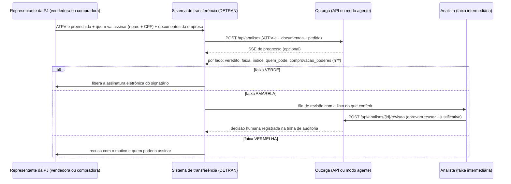

# Integração com o fluxo de transferência (proposta)

## Onde o Outorga entra

Antes de liberar a assinatura da **ATPV-e**, o sistema verifica quem assina por **cada pessoa jurídica** envolvida:
pelo **vendedor** (antigo proprietário) e/ou pelo **comprador** (novo proprietário). Pessoa física assina em nome
próprio e fica fora da verificação. Com PJ dos dois lados, o resultado geral é o do lado mais fraco.



O § 7º do art. 28 da Res. CONTRAN 1.027/2026 pede a comprovação "por consulta a bases oficiais ou por instrumento de
outorga verificável". O Outorga cobre o segundo caminho hoje (documentos) e foi desenhado para receber o primeiro
(QSA/situação cadastral da Receita, Junta Comercial) como fonte adicional de fatos.

## Chamadas

A API sobe em `http://127.0.0.1:8765` (`uv run outorga serve`); a documentação interativa (OpenAPI) fica em `/docs`.

### 0. Consulta por CPF, antes da ATPV-e (fluxo principal pedido pelo chefe em 17/10/2026)

Basta o veículo, o papel e o CPF de quem vai assinar. O proprietário vem da base veicular (no protótipo, simulada em
`corpus/base_veicular.json`; no DETRAN, a base RENAVAM — `GET /api/veiculo?placa=` mostra o que o sistema achou).

```bash
curl -s -X POST http://127.0.0.1:8765/api/analises \
  -F 'pedido={"veiculo":{"placa":"HNM2Z92"},"papel":"vender","cpf":"<CPF de quem vai assinar>"}'
# documentos são opcionais: o próprio dono pessoa física assinando não precisa de nenhum
```

| Situação | Resposta |
|---|---|
| Dono (ou comprador) **empresa** | confere o CPF no contrato social/estatuto/atas e nas procurações anexadas |
| **Pessoa física** e o CPF é o do próprio dono/comprador | 🟢 aceito: assina em nome próprio |
| Pessoa física e o CPF é **outro** | sem procuração que cite esse CPF → 🟡 `pendencias: [{"tipo": "procuracao"}]` ("tem procuração?"); com procuração → confere quem outorgou (tem de ser o titular registral), poderes (vender ≠ comprar; poderes gerais não bastam), veículo, prazo, revogação, substabelecimento e forma (DETRAN-CE: pública, até 1 ano) |
| Empresa e o CPF não tem poder pelos atos | sem procuração que cite esse CPF → 🟡 pede a procuração antes de recusar |

Linha de comando: `uv run outorga consultar --placa HNM2Z92 --cpf <CPF> --papel vender [procuracao.pdf ...]`.
No modo agente, o `pedido.json` da pasta pode vir neste mesmo formato.

### 1. Enviar uma análise (com a ATPV-e ou com todos os dados)

A **ATPV-e** é a entrada principal: dela saem o veículo, o vendedor, o comprador (com CPF/CNPJ), o valor, a data e as
assinaturas eletrônicas já registradas. O pedido só precisa dizer **quem vai assinar** por cada PJ (o que vier no
pedido prevalece sobre a ATPV-e; divergências de placa/CNPJ viram aviso).

```bash
curl -s -X POST http://127.0.0.1:8765/api/analises \
  -F 'arquivos=@ATPV-e.pdf' -F 'arquivos=@contrato_social_vendedora.pdf' \
  -F 'arquivos=@estatuto_compradora.pdf' -F 'arquivos=@ata_eleicao_compradora.pdf' -F 'arquivos=@crlv.pdf' \
  -F 'pedido={"vendedor":  {"assinantes":[{"nome":"Carlos Eduardo Bezerra","cpf":"417.075.364-06"}]},
              "comprador": {"assinantes":[{"nome":"Manoel Messias Freitas","cpf":"..."}]},
              "forma_assinatura":"ATPV-e"}'
# → {"id": "20261017-005925-060d01"}
```

Sem a ATPV-e, informe tudo no pedido:

```json
{"veiculo": {"placa": "HLR1N35", "renavam": "...", "chassi": "...", "descricao": "FIAT/TORO"},
 "data_venda": "2026-09-18", "valor": 165000,
 "vendedor":  {"tipo": "PJ", "nome": "LOCADORA JANGADA LTDA.", "documento": "38.005.305/0001-69",
               "assinantes": [{"nome": "Pedro Henrique Lima", "cpf": "939.761.584-02"}]},
 "comprador": {"tipo": "PF", "nome": "Rita de Cássia Moreira", "documento": "529.982.247-25"}}
```

- Os documentos de cada empresa são separados pelo **CNPJ** (e pela razão social) citado em cada um.
- `assinantes` vazio = **consulta** ("quem pode assinar?"), devolvida como indeterminada, com a lista de quem pode.
- Comprador PJ sem nenhum documento da empresa = faixa intermediária ("anexe o ato constitutivo").
- `amostras: 3` = análise profunda (3 leituras + voto; ~3× mais lenta).
- CNPJ do pedido diferente do CNPJ dos documentos = bloqueio.
- O formato antigo (só `assinantes` do vendedor no topo) continua aceito.
- `POST /api/atpv/ler` (campo `arquivo`) devolve os dados lidos de uma ATPV-e, para pré-preencher a tela.

### Modo agente (pasta vigiada, sem integração por API)

```bash
uv run outorga agente --entrada /srv/outorga/entrada --saida /srv/outorga/saida
# ou como serviço: scripts/outorga-agente.service (systemd --user), que chama scripts/agente.sh
```

Cada pedido é uma **subpasta** (ou um `.zip`) em `entrada/` com a ATPV-e, os documentos das empresas e, se quiser,
um `pedido.json` (mesmo formato acima). O agente processa a pasta quando aparece o arquivo `PRONTO` ou quando nada
muda nela por 10 s; grava em `saida/<pedido>/` o `resultado.json`, o `parecer.pdf`/`.html` e um `resumo.txt`; registra
a análise na mesma trilha de auditoria da interface; e move a entrada para `entrada/processados/` (ou
`entrada/com_erro/`, com `erro.txt`). Se a IA local estiver fora do ar, o pedido espera na fila. `--uma-vez` processa o
que houver e sai (bom para cron). O estado do agente fica em `saida/agente_status.json`.

### 2. Acompanhar e obter o resultado

```bash
curl -N http://127.0.0.1:8765/api/analises/{id}/eventos     # SSE: documento lido, tarefa concluída, motor, concluído
curl -s http://127.0.0.1:8765/api/analises/{id}             # resultado completo (campo "resultado")
curl -s http://127.0.0.1:8765/api/analises/{id}/parecer.pdf -o parecer.pdf
```

Campos estáveis do resultado para o sistema de transferência:

| Campo | Uso |
|---|---|
| `lados.vendedor`, `lados.comprador` | resultado completo de cada PJ (todos os campos abaixo, por lado) |
| `geral` | combinação dos lados (o mais fraco decide); no topo do resultado quando há PJ dos dois lados |
| `pedido_atpv` | o pedido completado com a ATPV-e ou com a base veicular (veículo, partes, valor, data, assinantes) |
| `pendencias[]` | o que pedir a quem está no balcão: `procuracao`, `ato_constitutivo`, `alteracoes`, `valor`, `ata_aprovacao`, `crlv` |
| `veredito` | `PODE` · `NAO_PODE` · `INDETERMINADO` |
| `faixa`, `indice` | decisão automática (VERDE/VERMELHO) ou fila de revisão (AMARELO) |
| `quem_pode[].pessoas[]` | combinações mínimas que obrigam a empresa (nome + chave/CPF) |
| `assinantes[]` | como cada assinante informado foi identificado (CPF ou nome) |
| `comprovacao_poderes` | os cinco elementos do § 7º (outorgante, outorgado, poderes, prazo, revogação) |
| `achados[]`, `caminho_escolhido.achados[]` | o que foi verificado, com severidade, fundamento e trecho do documento |
| `motivos_faixa` | por que caiu nesta faixa (ex.: "alerta: procuração particular") |
| `hash_entrada`, `auditoria.hash` | integridade (documentos + pedido) e elo na trilha de auditoria |

### 3. Simular e revisar

```bash
# "E se a sócia também assinar?" — instantâneo, sem reler documentos, não grava ("lado": vendedor | comprador)
curl -s -X POST http://127.0.0.1:8765/api/analises/{id}/simular -H 'content-type: application/json' \
  -d '{"lado":"vendedor","assinantes":[{"nome":"Maria Clara Fontenele","cpf":"..."}]}'

# Decisão do analista na faixa intermediária (vira rótulo para calibrar os limiares)
curl -s -X POST http://127.0.0.1:8765/api/analises/{id}/revisao -H 'content-type: application/json' \
  -d '{"decisao":"aprovar","revisor":"matrícula 1234","justificativa":"certidão simplificada conferida"}'
```

### 4. Política e calibração

```bash
curl -s http://127.0.0.1:8765/api/politica                     # perfil DETRAN-CE e limiares atuais
curl -s -X PUT http://127.0.0.1:8765/api/politica -H 'content-type: application/json' \
  -d '{"perfil":"ce","limiar_aceite":90,"limiar_recusa":10}'
curl -s http://127.0.0.1:8765/api/calibracao?alfa=0.05          # curva risco × cobertura e limiares sugeridos
curl -s http://127.0.0.1:8765/api/auditoria                     # cadeia de hashes e verificação de integridade
```

## Requisitos para produção (fora do escopo do protótipo)

- autenticação e autorização (a API do protótipo escuta só em 127.0.0.1 e não tem login);
- servidor de inferência dedicado (o protótipo usa uma RTX 3060 compartilhada; ~1–2 min por caso);
- armazenamento e retenção dos documentos conforme a política de dados do órgão (LGPD);
- integração com a base veicular do DETRAN (proprietário por placa/RENAVAM), com as bases oficiais (Receita/Junta) e com
  a validação da assinatura ICP-Brasil/avançada da ATPV-e; procurações públicas podem ser confirmadas na CENSEC (que
  informa a existência do ato; a revogação se confere por certidão do cartório de origem);
- calibrar o leitor de ATPV-e com o PDF oficial (o protótipo usa um layout simulado e cai na IA se não reconhecer);
- piloto com processos reais anonimizados para recalibrar a faixa intermediária.
